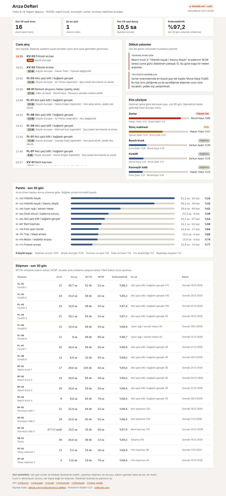

# Arıza Defteri

Depo ekipmanı için **ortak arıza kayıt servisi**. Forklift, reach truck, konveyör, sorter ve streç makinesi arızaları tek yerde tutulur. Nabız (TPM), Usta (çağrı yönlendirme) ve Emanet (tek kişiye bağımlılık haritası) aynı veriyi kendi açılarından okur.

Veri **sentetiktir**. Kurgusal Yıldız Ev & Yaşam deposunda her gün kurallı ve hikâyeli desenlerle üretilir. Yaşlanan ekipman sık bozulur, bakımı geciken daha da sık bozulur. Reach truck 3 cuma günleri hidrolik sorunu çıkarır. Sorter'ı neredeyse yalnız Murat Kaya bilir, o izindeyken onarımlar uzar. Panonun ve API'nin işi bu desenleri bulmaktır.

Ticari olmayan bir portföy projesidir. Arayüz Türkçedir.



## Ne yapar

- **Canlı görünür, arkada sürekli süreç yoktur.** Üretici yarının kayıtlarını önceden yazar. API yalnız saati gelmiş kaydı gösterir. Başlamış ama bitmemiş arıza "açık" görünür, sonucu gizlidir.
- **Tekrarlanabilir.** Her günün tohumu tarihten türer. Aynı gün kaç kez üretilirse üretilsin aynı kayıtlar çıkar.
- **TPM göstergeleri:** MTTR, MTBF, kullanılabilirlik, arıza Pareto'su, 6 büyük kayıp dağılımı ve planlı bakım durumu.
- **Kim çözüyor:** Ekipman tipine göre teknisyen payı gösterilir. Tek kişiye bağımlılık Emanet'in sinyalidir.
- **Dikkat çekenler:** Veriden kurallarla çıkan bulgular. Bir güne yığılan arıza binom testiyle bulunur, tesadüfi dalgalanma elenir. Tek kişiye bağımlılık ve geciken bakım da listelenir.
- **Gerçek kayıt:** Yazma anahtarı olan uygulama (Nabız) gerçek arıza bildirir ve kapatır. Sentetik ve gerçek kayıt `kaynak` alanıyla ayrılır.

## Yapı

```
src/cekirdek/  katalog (ekipman, kişi, arıza türü) · üretici (tohumlu, saf fonksiyon) · analiz (MTBF, Pareto, bulgular)
server/        servis (kurallar) ─┬─ web kapısı  /v1   ─▶ arayüz (web/), Nabız, Usta, Emanet
                                  └─ MCP kapısı  /mcp  ─▶ Claude ve diğer MCP istemcileri (salt okuma)
               store (SQLite) · zamanlayıcı (saatlik: eksik günleri tamamla, eskileri özetle)
```

## Kendi bilgisayarında dene

Node.js 22.13 ya da üstü gerekir.

```bash
npm install
npm run start:dev                       # http://localhost:8080 (ilk açılışta 360 günlük geçmiş üretilir)
npm test                                # üretici desenleri, analiz, depo, API ve MCP testleri
npm run uret -- --goster 2026-11-27     # bir günü yazmadan ekrana dök
```

## API (özet)

| Yol | Ne döner |
| --- | --- |
| `GET /v1/durum` | Son üretim, kayıt sayısı, bugünün tarihi |
| `GET /v1/arizalar?gun=7&ekipman=RT-03&tur=RT-HID&acik=1&kaynak=sentetik&limit=200` | Kayıtlar (yeniden eskiye) |
| `GET /v1/arizalar/{id}` | Tek kayıt |
| `GET /v1/ozet?gun=30&tip=forklift` | Ekipman başına MTTR/MTBF/kullanılabilirlik, Pareto, kayıplar |
| `GET /v1/ekipman`, `GET /v1/ekipman/{kod}` | Ekipman ve bakım durumu, tek ekipman detayı |
| `GET /v1/uretim?gun=30&ekipman=SR-01` | Biten vardiyalarda planlı süre, duruş, iş adedi, hatalı (OEE girdisi) |
| `GET /v1/cozenler?gun=90` | Kim çözüyor, tek kişiye bağımlılık riski |
| `GET /v1/bulgular?gun=90` | Dikkat çekenler |
| `GET /v1/ana-veriler` | Ekipman, arıza türü, kişi, kayıp kodları |
| `POST /v1/arizalar` (anahtar) | Gerçek arıza bildir |
| `POST /v1/arizalar/{id}/kapat` (anahtar) | Gerçek arızayı kapat |

Ayrıntı: [docs/API.md](docs/API.md). MCP: [docs/MCP.md](docs/MCP.md).

## Belgeler

- [Proje dokümanı](docs/PROJE.md): kararlar, mimari, kod turu, testler, mülakat soruları (yaşayan rehber)
- [Sunucu kurulumu](docs/SUNUCU_KURULUMU.md): ariza.ysfdurak.com adresinde yayın

## Lisans

Bu proje [PolyForm Shield 1.0.0](LICENSE.md) lisansıyla yayınlanır. Kaynak kodu açıktır, ancak resmi anlamda bir "açık kaynak" lisansı değildir. Senaryo dosyası (`src/cekirdek/senaryo.json`) ve katalog verisi de aynı lisansa tabidir.

- **Serbest:** Kişiler, okullar ve şirketler kendi işlerinde ücretsiz kullanabilir, değiştirebilir ve kendi bilgisayarlarına ya da sunucularına kurabilir. İzin almak gerekmez.
- **Yazılı izin gerekir:** Yazılımı satmak, adını değiştirip ürün gibi sunmak ya da bununla (ücretsiz olsa bile) rakip bir ürün veya hizmet sunmak.
- **Garanti yok:** Yazılım olduğu gibi sunulur. Bağlayıcı olan İngilizce lisans metnidir.
- Üçüncü taraf bileşenler kendi lisanslarına tabidir.

Kurumunuzda kullanıyorsanız haber verirseniz sevinirim: kurulumda yardımcı olabilir, kurumunuza özel ihtiyaçları birlikte değerlendirebiliriz. Kurum içi kurulum için [docs/SUNUCU_KURULUMU.md](docs/SUNUCU_KURULUMU.md) yeterlidir. Gerçek veriyle kullanırken `.env` içinde `SENTETIK=false` yapın, sentetik üretim tamamen kapanır. İletişim: iletisim@ysfdurak.com

### License (English)

Released under [PolyForm Shield 1.0.0](LICENSE.md). The source is available, but this is not an OSI "open source" licence. The scenario file and catalogue data are covered by the same licence.

- **Free:** individuals, schools and companies may use it in their own work, change it and run it on their own computers or servers. No permission needed.
- **Needs written permission:** selling it, rebranding it as a product, or providing a product or service that competes with it (even free of charge).
- **No warranty:** provided as is. The English licence text is binding.
- Third-party components keep their own licences.

Using it in your organisation? I'd be glad to hear from you: I can help with setup and look at your organisation's needs together. Contact: contact@ysfdurak.com
