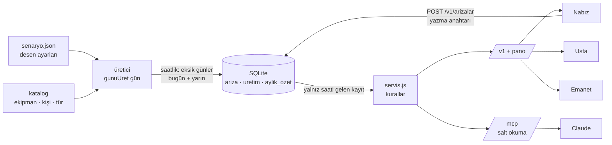

# Arıza Defteri: proje dokümanı

Bu doküman, kodu ben yazmamış olsam bile projeyi baştan sona anlatabilmem ve savunabilmem için tutulur. Ortak altyapı (GitHub, Cloudflare, VPS, Docker, Caddy, güvenlik temeli, lisans) burada tekrar anlatılmaz: [ysfdurak.com → docs/](https://github.com/ysfdurak/ysfdurak.com/tree/main/docs) ve [sunucu/README.md](https://github.com/ysfdurak/ysfdurak.com/blob/main/sunucu/README.md).

Son güncelleme: 24 Kasım 2026 (V0).

---

## 1. Bir bakışta

| | |
| --- | --- |
| **Ne** | Depo ekipmanı için ortak arıza kayıt servisi ve hikâyeli sentetik veri üreticisi. Web panosu, `/v1` API'si ve MCP kapısı var. |
| **Kimin için** | Üç uygulama okur. Nabız (TPM uygulaması) duruş ve kayıp analizi için, Usta çağrıyı doğru teknisyene yönlendirmek için, Emanet tek kişiye bağımlılığı göstermek için. İnsan olarak bakım şefi ve depo yöneticisi panoya bakar. |
| **Canlı adres** | https://ariza.ysfdurak.com **[doğrulanacak: henüz kurulmadı]** |
| **Depo** | github.com/ysfdurak/ariza-defteri **[doğrulanacak: henüz gönderilmedi]** |
| **Durum** | V0 bitti: çekirdek, üretici, API, MCP, pano, testler, Docker. Sırada Nabız V1 var. |
| **Kapsam dokümanı** | "Arıza Defteri + Nabız — Kapsam Dokümanı" (Claude Docs) |

## 2. Sorun ve verdiğim kararlar

**Sorun.** Portföydeki üç proje (Nabız, Usta, Emanet) aynı ham veriye ihtiyaç duyuyor: hangi ekipman, ne zaman, neden durdu, kim çözdü. Her biri kendi sahte verisini üretseydi kişiler ve ekipmanlar birbirini tutmazdı. Elimde gerçek veri de yok.

| Karar | Neden | Bedeli |
| --- | --- | --- |
| Arıza kaydı **ayrı bir servis**, üç uygulama buradan okur | Tek kaynak: aynı teknisyen Emanet'te de Usta'da da aynı kişi | Servis çökerse tüketiciler eski veriyle kalır. Bunun için her tüketici son veriyi önbellekte tutar. |
| Nabız, Yalın Araçlar'ın modülü değil **ayrı proje** | Kullanıcısı (sahadaki operatör) ve altyapısı (giriş, QR, kalıcı veri) farklı | İki depo, iki kurulum |
| Veri **her gün sentetik** üretilir, rastgele değil **hikâyeli** | Demo canlı görünsün, analizin bulacağı gerçek desenler olsun | Desenleri ben tasarladığım için "bulunan" şey önceden bilinen şey. Mülakatta açıkça söylenir. |
| **Gece toplu üretim, gün içinde canlı görünüm** | Arkada sürekli süreç olmasın ama pano canlı görünsün | Yarının kayıtları veritabanında hazır durur. Görünürlük kuralı tek yerde (store) uygulanmalı. |
| Ücretli API ve yapay zekâ yok | Maliyet sıfır, kural tabanlı analiz açıklanabilir | Bulgular yalnız tanımlı kurallar kadar akıllı |
| VPS'te çalışır | Kalıcı veri, saatlik iş, Nabız'dan yazma | Sunucu bakımı |

## 3. Mimari ve veri akışı



**Görünürlük kuralı** projenin kalbidir:

```
üretici 25 Kasım'ı 24 Kasım'da yazar ──▶ veritabanında 12 kayıt hazır
API'ye 25 Kasım 10:20'de sorulur:
  başlangıcı 10:20'den sonra olan kayıt  → hiç dönmez
  başlamış, bitişi 10:20'den sonra olan  → "açık" döner; bitiş, süre, çözen, işlem gizli
  bitmiş                                  → olduğu gibi döner
```

## 4. Teknoloji seçimleri

| Seçim | Neden | Elenen alternatif |
| --- | --- | --- |
| Node 22 + yerleşik `node:sqlite` | Pusula, Diyalog ve Destek ile aynı yığın. Güvenlik temeli, Dockerfile ve Caddy kalıpları birebir kullanılır. Ek veritabanı paketi yok. | Python/FastAPI. Kapsam dokümanında bunu yazmıştık. Diğer projelerle kalıp birliği bozulacağı için vazgeçtik. |
| Çerçevesiz HTTP (`node:http`) | Az bağımlılık, her satır okunur, CSP ve başlıklar elde | Express, Fastify |
| Saf fonksiyon üretici + tarihten türeyen tohum | Aynı gün hep aynı çıktıyı verir, testler tekrarlanabilir, geçmiş tek döngüyle dolar | Veritabanında "durum" tutan, adım adım ilerleyen simülasyon. Bir gün kaçarsa zincir bozulurdu. |
| Sunucu içi saatlik zamanlayıcı | Sunucu bir gece kapalı kalsa da açılınca eksikleri tamamlar. Host'ta cron ayarı gerekmez. | Host cron + `docker exec`. Kapsam dokümanında bu vardı. |
| Senaryo JSON | Ek paket gerekmez | YAML. Okunurluk biraz daha iyi ama paket ister. |
| Binom testiyle "tekrarlayan gün" bulgusu | Basit eşik (ör. "%35'ten fazlası aynı gün") 90 günlük veride 4 yanlış alarm verdi. Test yalnız gerçek deseni buluyor. | Sabit eşik, yapay zekâ |
| MCP stateless, salt okuma | Yazma yalnız anahtarlı API'den. MCP'den veri bozulamaz. | Yazma araçları |

## 5. Kod turu

| Dosya | Ne yapar | Dikkat |
| --- | --- | --- |
| `src/cekirdek/katalog.js` | 18 ekipman, 24 arıza türü, 23 kişi. `oran` vardiya başı olasılık, `mttr` medyan onarım süresi, `operator: true` basit duruşu operatörün kendisinin giderdiğini belirtir. | Kod silinmez, yeni kod eklenir (eski kayıtlar bağlı). |
| `src/cekirdek/rastgele.js` | FNV-1a özet + mulberry32 üreteci. Poisson, normal ve ağırlıklı seçim. | Kriptografik değil, yalnız simülasyon için. |
| `src/cekirdek/uretici.js` | `gunuUret(gun)` bir günün kayıtlarını, `vardiyaUretimi` vardiya üretimini üretir. `bakimDurumu`, `izinde`, `carpanlar`, `asinmaCarpani` hepsi tarihten hesaplanır. | Döngü sırası sabit (vardiya → ekipman → tür). Sıra değişirse aynı tohum farklı veri üretir. |
| `src/cekirdek/analiz.js` | `ekipmanOzeti` (MTTR, MTBF, kullanılabilirlik), `pareto`, `kayipDagilimi`, `cozenDagilimi`, `bulgular` | Planlı bakım duruş sayılmaz ve çalışma süresinden düşülür. |
| `server/store.js` | SQLite. `gunuYaz` önce o günün sentetiklerini siler, sonra yazar (çift kayıt olmaz). `kayitlar` görünürlük kuralını uygular. | Bütün SQL parametreli. |
| `server/servis.js` | Web ve MCP'nin çağırdığı kurallar: girdi denetimi, dönem, pano önbelleği (dakikada bir), gerçek kayıt bildir ve kapat. | Kişi kodu, ekipman kodu ve tür-ekipman uyumu burada denetlenir. |
| `server/app.js` | Yollar, güvenlik başlıkları, CSP, hız sınırı, Origin ve Sec-Fetch-Site denetimi, gövde sınırı, anahtar karşılaştırması (sabit sürede). | Kural içermez. |
| `server/mcp.js` | 8 salt okuma aracı | Kural içermez. |
| `server/zamanlayici.js` | `uretimiTamamla`: eksik günler, bugün ve yarın; saklama süresini aşanı özetleyip siler. | `uretim` satırları silinmez, eski günler yeniden üretilmez. |
| `web/app.js` | Tek istek (`/v1/pano`), dakikada bir yenilenir. Her metin `textContent` ile yazılır. | Çubuk genişliği CSSOM ile verilir (CSP satır içi stile izin vermez). |

**Desenler nasıl veriye giriyor?** Bir arızanın beklenen sayısı (Poisson ortalaması) şu çarpımla bulunur:

```
kullanım(dk) = 480 × doluluk(0,75) × sezon(kasım 1,35 · aralık 1,25 …) × gün(pazar 0,5 · cumartesi 0,85) × gece(0,6) ± %10   (en çok 480)
ortalama     = tür.oran × yoğunluk(3) × yaş(1 + 0,08 × yıl) × aşınma(x) × kullanım / (480 × 0,75)
             × otonom bakım(forklift, 1 Eylül 2026'dan sonra 0,7)
aşınma(x)    = β · x^(β−1)    x = bakımdan beri ÇALIŞILAN süre / bir periyodun ortalama çalışma süresi
               β türün gizli "asinma" değeri (0 ≤ x ≤ 1 aralığında ortalaması 1: bakım gecikince x > 1, aşınan türde arıza hızla artar)
RT-03 + RT-HID + cuma (1. ve 2. vardiya): ayrıca %65 olasılıkla 1 arıza
Çözen: uzmanlık³ × (vardiyada 1 · vardiya dışı 0,5) ağırlıkla; izindeki seçilmez; uzmanlık < 0,5 ise süre × 2,2
```

**Akü şarjı arıza değildir (surum 5, 26.11.2026):** surum 4'e kadar forkliftte ve reach truckta en sık "arıza" türü "akü şarjı bitti" idi (forklift başına yılda ~96). Şarjın bitmesi şarj planının işidir, ekipman bozulmamıştır; arıza kaydına girerse Pareto'nun tepesine yerleşir ve asıl bozulmaları gizler. Bu yüzden çıkarıldı. `FL-AKU` ve `RT-AKU` kodları kaldı ama artık yalnız gerçek arızayı anlatıyor: **akü soketi ya da kablosu hasarlı** (oran 0,0015 ve 0,0012; teknisyen gerekir, MTTR 45 dk). Sonuç: forklift başına yılda ~163 kayıt (63'ü arıza).
- **Şöyle daha iyi olur:** Sahada bakım ekibi gerektiren forklift arızası ayda birkaç tanedir. Burada hidrolik kaçak tek başına yılda 32. Yoğunluğu düşürmek veriyi gerçekçi yapar, ama analizin aşınmayı görebilmesi için gereken arıza sayısı da azalır. Karar bekliyor.

**Kullanım (V3, surum 4):** Ekipman her vardiyanın tamamında çalışmaz; kullanılan süre sezona, haftanın gününe ve vardiyaya göre değişir (`kullanimDk`). Arıza olasılığı kullanılan süreyle orantılıdır ve aşınma, bakımdan beri geçen güne değil bakımdan beri çalışılan süreye göre ilerler (sayaç).
- **İçeride ne oluyor:** Forkliftte 30 günlük bakım periyodu ortalama 447 çalışma saati eder. Ama mayısta 30 gün ~383 saat, aralıkta ~536 saat (%40 fark). Takvime göre bakım, yoğun dönemde ekipmanı daha "yaşlı" yakalar.
- **API:** `bakimDurumu` artık `bakimdanBeriSaat` (sayaç) ve `periyotSaat` (bir takvim periyodunun ortalama çalışması) döndürür; `/v1/ozet` ve `/v1/ekipman` ekipman satırında görünür. Nabız'ın Bakım ekranı bunu gösterir.
- **Vardiya üretimi de değişti:** planlı süre = ekipmanın o vardiyada kullanıldığı süre (boşta beklediği süre OEE'ye girmez). Duruş, kullanılan süreyle sınırlıdır.
- **Bu yapı uygun değil, şöyle uygulanır:** İlk sürümde sezon arıza oranını doğrudan çarpıyordu ("kasımda her şey daha çok bozulur"). Gerçekte ekipman kasımda daha çok çalıştığı için daha çok bozulur. Etkiyi doğru yere (kullanıma) koymak, takvim-sayaç karşılaştırmasını mümkün kıldı.

**Gizli β (V2):** 10 türün aşınma davranışı var (ör. RT-MAS 2,5, ST-AYR 0,6). Değer API'den verilmez. Nabız Analiz onu kayıtlardan kör tahmin eder, kör deneme sonuçları onun dokümanında.

**Vardiya üretimi (V2, OEE girdisi):** `vardiyaUretimi(gun, kayitlar)` her ekipman ve vardiya için şunları üretir: planlı süre (kullanım − planlı bakım; V3'ten önce 480 dk − planlı bakım), duruş (o vardiyada başlayan arızalar), iş adedi (ideal hız × çalışma × %68–88 performans; hız kaybı varsa ×0,85) ve hatalı adet (binde 4 + kalite arızası başına %1). `/v1/uretim` yalnız bitmiş vardiyaları gösterir. Nabız OEE'yi bundan hesaplar.

**Sürüm:** `senaryo.json` → `surum` değişince saklanan günler yeni kurallarla kendiliğinden yeniden üretilir (gerçek kayıtlara dokunulmaz). V0 → 1, aşınma → 2, performans aralığı → 3, kullanım ve sayaç → 4.

## 6. Sunucu ve yayın

Ortak kalıp: [sunucu/README.md](https://github.com/ysfdurak/ysfdurak.com/blob/main/sunucu/README.md). Bu projeye özgü olanlar:

- Kurulum: `bash ~/ysfdurak.com/sunucu/kurulum-ariza.sh`. Kodu çeker, `.env`'i yazma ve MCP anahtarlarıyla üretir, konteyneri kurar, Caddy'yi yeniden başlatır.
- Önce Cloudflare'de `ariza` için A kaydı açılmalı (proxy açık).
- Konteyner: `ariza-defteri`, `web` ağında, port açmaz. Salt okunur kök, `cap_drop: ALL`, 256 MB bellek.
- İç erişim: Nabız, Usta ve Emanet aynı ağdan `http://ariza-defteri:8080/v1/...` ile internete çıkmadan okur.
- Yedek: yok. Sentetik veri tarihten yeniden üretilebilir. Nabız gerçek kayıt yazmaya başlarsa yedeğe eklenmeli.
- Elle yeniden üretim: `sudo docker exec ariza-defteri node --disable-warning=ExperimentalWarning tools/uret.js --gun 30 --yeniden`

## 7. Testler

`npm test`: 22 test, yaklaşık 3 saniye.

| Dosya | Neyi kanıtlıyor |
| --- | --- |
| `uretici.test.js` | Aynı gün aynı çıktı. Kayıtlar tutarlı. RT-03 cuma payı %40'ın üstünde. Sorter'da Murat'ın payı %70'in üstünde, izindeyken ortalama onarım 1,4 katından uzun. Geciken bakımda arıza 1,4 katından sık. Otonom bakımdan sonra forklift arızası azalıyor. |
| `analiz.test.js` | MTTR, MTBF ve kullanılabilirlik elle hesaplananla aynı. Pareto sırası ve kümülatif doğru. Üç farklı 90 günlük dönemde bulgular **yalnız** RT-03 cuma ve sorter/Murat. |
| `store.test.js` | Yeniden yazmada çift kayıt yok. Gelecek kayıt görünmüyor, açık arızanın sonucu gizli. Zamanlayıcı ikinci çalıştırmada bir şey yapmıyor, eski kayıt özetleniyor. |
| `api.test.js` | Güvenlik başlıkları, 400/404, gelecek kaydın 404 dönmesi, yazmada 401/403/413/409, hız sınırında 429, MCP anahtarsız 401, araçların salt okuma olması. |
| `gercek-ip.test.js` | Sahte `X-Forwarded-For` / `CF-Connecting-IP` ile hız sınırı atlatılamıyor. |
| `tarayici/duman_test.py` | Pano açık temada, koyu temada ve telefonda açılıyor, veri doluyor, konsolda hata ve CSP ihlali yok. |

Örneklem (24 Kasım 2026, yerel):

| Adım | Beklenen | Gözlenen | Durum |
| --- | --- | --- | --- |
| Panoyu aç | KPI, akış, Pareto, 18 ekipman | Hepsi dolu, açık arıza turuncu | ✓ |
| `/v1/arizalar/S-<yarın>-001` | 404 | 404 | ✓ |
| Anahtarsız POST | 401 | 401 | ✓ |
| Güvenlik taraması (`tara.py --audit`) | Temiz | Temiz | ✓ |
| Canlı adres | Açılır, başlıklar gelir | **[doğrulanacak: kurulumdan sonra]** | – |

Ekran görüntüleri: `docs/ekranlar/pano.png`, `pano-koyu.png`, `pano-telefon.png`.

## 8. Bilinen sınırlar ve sonraki adımlar

- Bulguları üreten desenler önceden bilinen desenler. Gerçek veride ayar gerekir (en az örnek sayısı, test eşiği).
- MTBF hesabı "planlı çalışma = vardiya sayısı × 8 saat" varsayımına dayanır. Gerçek kullanım saati (saat sayacı) yok.
- OEE yok: performans ve kalite oranı için üretim verisi gerekir (Nabız V2).
- Gerçek kayıtlar için yedek yok (şu an yazan uygulama yok).
- Pano tek dil (Türkçe).
- Sırada: Nabız V1 (QR, otonom bakım kontrolü, etiket, Pusula'ya iş). Sonra Usta ve Emanet'in buradan okuması.

## 9. Mülakat soruları

1. **Neden ayrı bir servis?** Üç uygulama aynı gerçeği görmeli. Teknisyen, ekipman ve arıza tek kaynakta durur. Tüketiciler gevşek bağlı: `/v1` sürümlü, servis düşerse son veriyle devam ederler.
2. **Sentetik veri nasıl "canlı" görünüyor?** Yarın önceden yazılıyor, API yalnız saati gelen kaydı gösteriyor. Başlamış ama bitmemiş arıza açık görünüyor. Sürekli çalışan süreç yok.
3. **Aynı gün iki kez üretilirse?** Tohum tarihten türüyor, çıktı birebir aynı. Yazmadan önce o günün sentetikleri siliniyor, gerçek kayıtlara dokunulmuyor.
4. **MTBF'yi nasıl hesapladın?** (Planlı çalışma − planlı bakım − duruş) / arıza sayısı. Planlı bakım arıza değildir, TPM'de çalışma süresinden düşülür.
5. **"Cuma deseni"ni nasıl buldun, neden basit eşik değil?** Her ekipman-tür çifti için o günün payı, deponun genel gün dağılımıyla binom testinden geçiyor ve çoklu karşılaştırma için düzeltiliyor. Basit eşik 90 günde 4 yanlış alarm verdi, test yalnız gerçeğini buluyor.
6. **Tek kişiye bağımlılığı nasıl ölçüyorsun?** Ekipman tipi başına teknisyenlerin onarım payı. Operatörün kendi giderdiği basit duruşlar hariç. %70'in üstü yüksek risk.
7. **Güvenlik?** Okuma açık ama hız sınırlı. Yazma ve MCP için ayrı anahtarlar var, bellekte yalnız özetleri tutuluyor ve sabit sürede karşılaştırılıyor. Origin ve Sec-Fetch-Site denetimi, gövde sınırı, parametreli SQL, CSP `default-src 'self'`, konteyner salt okunur ve yetkisiz.
8. **Gerçek veriyle kullanılabilir mi?** `SENTETIK=false` ile üretici kapanır. Nabız gerçek kayıt yazar. Analiz kodu iki kaynakta aynıdır.
9. **Neden yapay zekâ yok?** Kurallar açıklanabilir ve maliyeti sıfır. MCP ile Claude'a soru sorulabiliyor, yani yapay zekâ dışarıdan, veriye erişerek kullanılıyor.
10. **En zor kısım?** Bakım gecikmesini tarihten hesaplamak. Döngü planı, gecikme ve "bugün bakım günü mü" bilgisi bir önceki günün durumuna bakmadan bulunmalıydı.

## 10. Kendini test et

<details><summary>Saat 10:20'de, 10:05'te başlayıp 10:40'ta bitecek bir arıza API'de nasıl görünür?</summary>Durumu "açık" görünür. Bitiş, süre, çözen ve işlem null döner.</details>

<details><summary>Planlı bakım MTTR'yi etkiler mi?</summary>Hayır. Arıza sayısına ve duruşa girmez, yalnız planlı çalışma süresinden düşülür.</details>

<details><summary>Döngü sırasını (vardiya → ekipman → tür) değiştirirsem ne olur?</summary>Aynı tohum farklı sırada tüketilir. O günden sonra üretilen veri değişir. Eski günler `--yeniden` ile baştan üretilmedikçe karışık kalır.</details>

<details><summary>MCP anahtarıyla arıza yazılabilir mi?</summary>Hayır. MCP araçları salt okumadır. Yazma yalnız `/v1` ve yazma anahtarıyla yapılır, test bunu kontrol eder.</details>

<details><summary>Sorter neden "yüksek risk" çıkıyor?</summary>Murat Kaya'nın sorter uzmanlığı 1, diğerlerinin 0,3 ve altında. Uzmanlık³ ağırlığıyla onarımların yaklaşık %86'sı ona düşüyor.</details>

## 11. Elle yapılacak alıştırma

**Değişiklik (10 dakika):** `src/cekirdek/senaryo.json` içindeki `tekrarlayan` listesine ikinci bir desen ekle: KV-02, `KV-BNT` (bant kayması), `haftaGunu: 1` (pazartesi), `vardiyalar: [1, 2]`, `olasilik: 0.8`. Sonra:

```bash
rm -rf tmp && npm run start:dev    # 180 gün yeniden üretilir
```

Panodaki "Dikkat çekenler"de KV-02 pazartesi bulgusu çıkmalı (90 günde yaklaşık 22/46). Önce `vardiyalar: [1]`, `olasilik: 0.6` ile dene: desen veride vardır ama test onu bulamaz, çünkü 90 günde tesadüften ayırmaya yetecek kadar güçlü değildir. Yanlış alarmı önleyen sıkı eşiğin bedeli budur, mülakatta anlatmaya değer. `tests/analiz.test.js` artık başarısız olur, çünkü beklenen bulgu listesi değişti. Testi de güncelle. Bu, testin "yalnız tasarlanan desenler" iddiasını nasıl koruduğunu gösterir.

**5 dakikalık demo:**
1. Panoyu aç. Sentetik veriyi, canlı görünümü ve turuncu "açık" arızayı göster.
2. "Dikkat çekenler"de RT-03 cuma bulgusunu oku, binom testini bir cümleyle anlat.
3. "Kim çözüyor"da sorter → Murat'ı göster. Emanet ve Usta'nın bunu nasıl kullanacağını söyle.
4. Pareto'da ilk iki satırın (hidrolik) duruşun üçte birini aldığını göster.
5. `/v1/arizalar/S-<yarın>-001` adresini açıp 404'ü göster: "yarının kaydı hazır ama görünmüyor".
6. Claude'a MCP üzerinden "Bu ay en çok duran ekipman hangisi, neden?" diye sor.

## 12. Değişiklik günlüğü

| Tarih | Değişiklik |
| --- | --- |
| 26.11.2026 | surum 5: akü şarjının bitmesi arıza sayılmıyor; FL-AKU/RT-AKU artık "akü soketi / kablosu hasarlı" (seyrek, teknisyen). Veri açılışta yeniden üretilir. 23 test. |
| 26.11.2026 | V3 (surum 4): kullanım. Vardiyada kullanılan süre sezon, gün ve vardiyaya göre değişir; arıza olasılığı kullanımla orantılı, aşınma bakımdan beri çalışılan süreyle ilerler. Bakım durumuna sayaç (`bakimdanBeriSaat`, `periyotSaat`). Planlı süre = kullanım. 23 test (kullanım deseni eklendi; aşınma testi çalışma saatine göre). |
| 25.11.2026 | Ortak ölçüm ve geri bildirim (olcum.ysfdurak.com), yalnız ariza.ysfdurak.com'da; tek ekran "pano". Pano dakikada bir kendini yenilediği için süre yalnız sekme görünür ve kişi son 60 sn'de etkileşimdeyken sayılır: duvar ekranında açık kalan sekme süreyi şişirmez. CSP yalnız bu adres için genişletildi. Kurum kurulumunda betik yüklenmez. |
| 24.11.2026 | V2 için: türlere gizli aşınma β'sı (eski "gecikmede ×1,8 / bakım sonrası ×0,7" yerine sürekli Weibull yoğunluğu), vardiya üretimi ve `/v1/uretim` + MCP `vardiya_uretimi`, varsayılan geçmiş 360 gün (Nabız Analiz en az 180 ister), üretici sürümü değişince otomatik yeniden üretim, RT-03 cuma olasılığı %55 → %65 (aşınmayla birlikte deseni korumak için), sayfaya meta CSP. Bu turda fark edilen: güvenlik taraması `git ls-files` okuyor; dosyalar eklenmemiş yeni depoda boş tarayıp "temiz" demişti. Dosyalar eklenip yeniden tarandı, CSP bulgusu düzeltildi. |
| 24.11.2026 | Nabız için: `/v1/ana-veriler` artık ekipman tiplerinin çalıştığı vardiyaları (`tipler`) ve vardiya saatlerini (`vardiyalar`) da veriyor. Nabız kontrol uyumunu buradan hesaplar. |
| 24.11.2026 | V0: katalog, tohumlu hikâyeli üretici, analiz (MTTR, MTBF, Pareto, 6 büyük kayıp, kim çözüyor, binom testli bulgular), SQLite deposu ve görünürlük kuralı, `/v1` API (okuma açık, yazma anahtarlı), 8 araçlı salt okuma MCP, pano (açık/koyu/telefon), 21 test + tarayıcı duman testi, Docker/compose sertleştirmesi, ysfdurak.com kurulum betiği ve Caddy bloğu, güvenlik taraması temiz. Kapsamdan sapmalar: Python yerine Node, cron yerine iç zamanlayıcı, YAML yerine JSON. |
